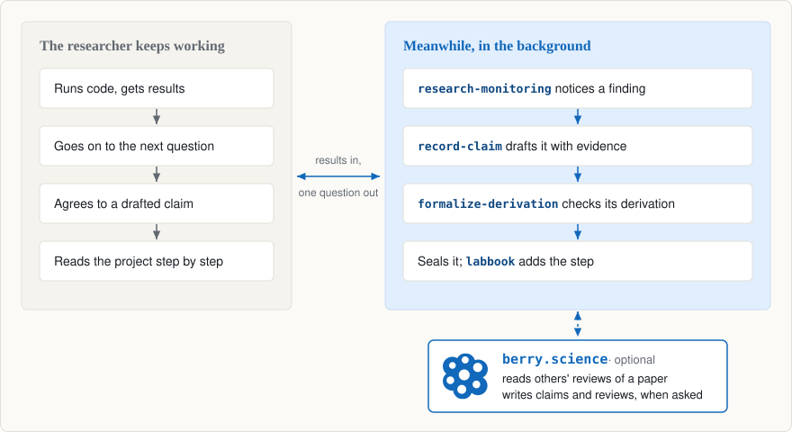

# Berry

**We document your whole research path** — the results, and the dead ends.

Dead ends go unpublished. A method that failed, a derivation that was
abandoned, an approach that broke down: none of it reaches a journal, so
the next person tries it again. Research done with an AI agent makes it
possible to keep all of it. **You do the research. Your AI agent
documents, checks and shares — with zero effort from you.**

This repository holds the open-source [agent skills](https://agentskills.io)
that do it, for Claude Code, Codex or any agent that reads agent skills.
While you work, your agent:

- **documents** each result and each dead end as a **claim**: the
  statement, the conditions it holds under, and its evidence — measurement
  data, derivations and code;
- **checks** it: every number against its evidence, every paper it uses at
  the passage it uses, every unit and sign against the project's
  conventions, every step of a derivation with an executable SymPy check;
- **remembers** it: before it relies on a fact or proposes a run, it looks
  in the claims — the problem may already be solved, by you or by a
  colleague;
- **keeps your labbook**: the project step by step, one claim per step, as
  a PDF in your own words;
- **shares** it, when you ask, with the
  [Berry Science Library](https://berry.science/library): checked before
  it goes up, and citable — private to you or your team unless you make
  it public.

Everything works locally and offline; the Library is optional. To
connect to it, join the pilot at
[berry.science/pilot](https://berry.science/pilot).

The repository also holds our **paper reviewer**, the agent we benchmark
for finding objective errors in papers: see
[skills/review-paper/README.md](skills/review-paper/README.md).

## How it works

**The claim is the unit of the research path**: one result or one dead
end, with the evidence behind it. Berry has two jobs — recording claims,
and recalling the ones already recorded. Everything else follows from
them. The labbook shows claims, one step each, and is never written in
their place; documenting a phase of work means recording its results and
dead ends as claims, in order, each citing what it builds on.

**You research; the agent documents beside you.** You keep working with
your agent as before. Noticing a result, drafting its claim, checking the
paper it rests on and writing the labbook all happen in the background.
The one thing that comes back to you is a single question per claim:
*agree to this?* — asked before anything builds on it.



- **Zero effort: nothing to write by hand.** A hook notices runs that
  printed results — and logs read later — and passes the agent a note
  without interrupting you; drafting a claim, checking a paper against
  the project's conventions and writing the labbook run as background
  agents.
- **The project remembers.** At the start of a session the agent gets
  every claim's title; before it relies on a fact, proposes a run or
  answers *"did we already check this?"*, it searches the claims instead of
  its memory.
- **A claim is small enough to check on its own**: one statement that could
  be false, the conditions it holds under, and the evidence behind it —
  reasoning, the output verbatim, the figure with its data, the code
  commit. Claims cite what they build on, so any result can be traced back
  step by step along the research path.
- **Sealed means unchanged.** Once you agree, the claim and everything it
  relies on — its evidence files, the wording of its conventions, the
  reviews of the papers it uses — are hashed. A change fails the check. A wrong claim is never edited; a newer claim refutes it, and
  the path keeps the wrong turns too.

## What it keeps

All of it in the research repository, committed with the code:

```
your-research-repo/
├── src/ …                                   your code
├── claims/                                  the ledger
│   ├── README.md                            index: claims, graph, conventions, papers checked
│   ├── conventions.json                     the project's conventions, versioned
│   ├── sources/arxiv-1706.03762/
│   │   └── 2026-10-12-eq-1.json             a passage of a paper, checked for one use
│   ├── audits/                              what each check found; a claim is re-checked only when something below it changes
│   └── 2026-10-10-scaled-attention-trains-stably/
│       ├── claim.json                       statement, conditions, citations, conventions, seal
│       └── evidence/                        reasoning, output verbatim, figure (Vega-Lite), data,
│                                            a derivation with its check script and output …
└── labbook/
    ├── labbook.tex                          the steps, in the researcher's voice
    ├── voice.md                             how the researcher writes
    └── claims.gen.tex                       boxes, figures, tables — generated from claims/
```

The PDF and the rendered figures are rebuilt, not committed.

## The skills

| Skill | Does | When |
|---|---|---|
| `research-monitoring` | Notices when a result or a dead end is a claim; has it drafted on the side | Throughout a session; the hook prompts it |
| `recall` | Looks in the claims before relying on memory: what was already run, shown or assumed | At session start (the titles, from a hook); before relying on a fact, proposing a run, or recording a claim; when the researcher asks what was done or doubts an answer |
| `record-claim` | Records a result or dead end as a claim: evidence, citations, conventions; checks and seals it | When a result is established or an approach fails, before anything builds on it |
| `formalize-derivation` | Gives a derivation an executable SymPy check: each labeled step judged by the helper, with mutants and an exported result | When a claim rests on a derivation; when asked to check or double-check one |
| `review-source` | Checks the passage of a paper a claim uses, against the paper's conventions and the project's; corrects it if wrong | Before a claim takes a value, equation or method from a paper |
| `conventions` | Keeps the project's conventions, versioned; compares each paper's | When a number depends on one; when taking anything from a paper |
| `labbook` | The project's steps as a LaTeX labbook, one claim per step, rebuilt as PDF after every change | After every sealed claim; when asked for an account of the project — never in place of recording claims |
| `check-claims` | Audits claims one at a time, then the chain they form | Before relying on a result, before publishing |
| `publish-claim` | Shares claims and reviews of papers with the Berry Science Library — citable, private by default | Only when the researcher asks |

**Papers.** A claim that uses a paper names the passage (`"Eq. (1)"`) and
the review that checked it. The review records what was read — LaTeX
source, the PDF, or nothing if the paper could not be obtained — the
paper's conventions mapped onto the project's, and a verdict: `holds`,
`holds_with_correction`, `fails`, `could_not_check`. A wrong passage is
corrected as a claim of its own and the work builds on the correction; the
check refuses a claim that builds on a passage found wrong. Shared, a
review is attached to the paper on berry.science, where everyone using the
same paper sees it.

**The labbook** places claims, figures and papers checked by reference
(`\claimbox{<id>}`) and never copies them, so it cannot say something the
ledger does not. A claim's figure is a Vega-Lite spec with its data inline:
the Library draws it on the web, and the labbook renders the same spec to a
vector PDF in the document's font. One spec, two renderings, the same
numbers.

The ledger is kept by one script, `claims.py`, described in the
[record-claim skill](skills/record-claim/SKILL.md); the formats are in
[claim-format.md](skills/record-claim/references/claim-format.md) and
[source-review-format.md](skills/review-source/references/source-review-format.md).

## With or without berry.science

| How you work | berry.science | What is kept where |
|---|---|---|
| **An agent in your repository**, offline | not needed | Everything above, in the repository. No account, no network — except to download a paper. |
| **The same, connected** | optional | As above, and on request: claims published (private by default), reviews of papers shared on the paper's page, other people's reviews looked up before a paper is used; earlier claims found by meaning, not only by keyword. |
| **A chat window** (Claude.ai, ChatGPT) | required | No repository, so the Library *is* the record: claims, reviews of papers and conventions are written there directly. |

Nothing leaves the machine unless the researcher asks for it to be
published.

## Install

Needs Python 3.9 or later. The labbook also needs LuaLaTeX (TeX Live or
MacTeX) and, for figures, `vl-convert-python` — or `uv`, which fetches it.
Derivation checks (`formalize-derivation`) need SymPy, mpmath and pint
(`python3 -m pip install sympy mpmath pint`) — or `uv`, which fetches the
versions each check script pins.

### Claude Code

```
/plugin marketplace add berry-science/berry
/plugin install berry@berry-science
```

This installs the skills (`/berry:research-monitoring`,
`/berry:record-claim`, …), the hooks and the background agents.

### Codex

```
codex plugin marketplace add berry-science/berry
```

then install `berry` with `/plugins` and start a new session. The hooks run
once you have reviewed and trusted them with `/hooks` — and again after an
update changes them. Background work is described for any subagent in each
skill's `references/`; where nothing runs in the background, the agent does
it after answering.

### What the hooks do

The plugin's hooks never block and never ask the researcher anything; each
hands the agent a short note, and the agent decides. They run in a
repository with a `claims/` folder, or where Berry is enabled in the
project's `.claude/settings.json`.

| When | Hook | Note |
|---|---|---|
| A session starts, resumes or is compacted | `recall/scripts/overview.py` | Every claim's title, the drafts waiting — or, without a ledger, that nothing is recorded yet |
| The user sends a message | `recall/scripts/nudge.py`, `research-monitoring/scripts/watch.py remind` | Look in the claims, when the message asks about earlier work or doubts an answer; a result noticed earlier with no claim drafted since; drafts waiting more than an hour (`BERRY_DRAFT_AGE`), once per session |
| A command printed results, or a run's output was read (`tail run.log`, the Read tool on a `.log`, `.out`, `.txt`, `.csv` or `.dat` file, a background command's output) | `research-monitoring/scripts/watch.py` | Decide whether it is a claim; at most once per 10 minutes per session (`BERRY_WATCH_INTERVAL`), with what was seen in between |
| A file in `claims/` or `labbook/` changed, or a claim was sealed | `labbook/scripts/labbook.py hook` | Rebuilds the PDF; reports a sealed claim without a step, a step without a claim, or — after the first sealed claim — that the labbook is to be created |

### Without the plugin

Copy the folders from `skills/` into the agent's skills directory —
`~/.claude/skills/` for Claude Code, `~/.agents/skills/` for Codex, or the
project-level equivalent. Keep them together: the other skills call
`record-claim`'s script as `../record-claim/scripts/claims.py`. There are
no hooks then: the agent applies the same tests itself, as the skills
describe. Other agents can wire `skills/research-monitoring/scripts/watch.py`
and `skills/labbook/scripts/labbook.py hook` to a post-tool hook,
`skills/recall/scripts/overview.py` to a session-start hook and
`skills/recall/scripts/nudge.py` to a hook on the user's message: each
reads the event as JSON on stdin and prints
`hookSpecificOutput.additionalContext`.

### Connecting berry.science (optional)

For publishing, sharing reviews of papers and looking up other people's —
and for **search by meaning**: connected, the `recall` skill finds earlier
claims by what they say, not only by the words they use, across the
researcher's claims, their team's and public ones. Offline, it searches the
ledger by keyword.

berry.science is in a pilot: to get an account, reach out to us at
[berry.science/pilot](https://berry.science/pilot). Then add the MCP
server and sign in with your berry.science account:

- Claude Code: `claude mcp add --transport http berry https://api.berry.science/mcp`
- Codex: `codex mcp add berry --url https://api.berry.science/mcp`

The plugin does not add it for you, so nobody working offline is asked to
sign in.

### Chat windows

In Claude.ai, ChatGPT or similar, the skills switch to their chat
procedures and berry.science is required. Setup:
[clients/chat/README.md](clients/chat/README.md).

## Repository layout

```
berry/
├── skills/                     one folder per skill (SKILL.md, scripts/, references/, templates/)
├── hooks/hooks.json            the hooks, for Claude Code and Codex
├── agents/                     the background agents, registered for Claude Code
├── .claude-plugin/             Claude Code plugin and marketplace
├── plugin.json                 Codex plugin
├── .agents/plugins/            Codex marketplace
├── clients/chat/               setup for Claude.ai and ChatGPT
└── tests/                      python3 -m unittest discover -s tests
```

## Contact

Berry Science is pre-launch and in active development, at Leibniz
University Hannover. If something here gets your research wrong, we would
like to hear about it: open an issue, or write to Gabriel Müller
(g.mueller@iqo.uni-hannover.de) or Christian Struckmann
(struckmann@iqo.uni-hannover.de).

## License

[Apache License 2.0](LICENSE). Copyright and attribution: [NOTICE](NOTICE).
