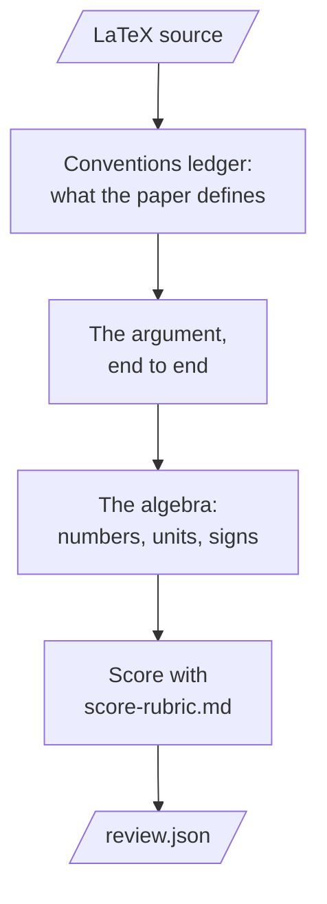

# The paper reviewer

`review-paper` is the review agent we benchmark at
[berry.science](https://berry.science): the same reviewer you can run on
your own papers that we run on ours. It stands apart from the research
harness in this repository; the harness's `review-source` skill borrows its
standard to check the one passage of a paper a claim uses.

## What it does

It reads a paper's **LaTeX source** and looks for **objective errors**: a
wrong number, an inconsistent unit, a flipped sign, a step that does not
follow, an invalid statistic, two parts of the paper that contradict each
other, a conclusion stronger than the results, an approximation used where
it does not hold. Separately, it may flag a *presentation weakness*: a
passage that is not wrong but that a reader in the field cannot follow.

It does not judge novelty, significance, style or writing quality. It is
told that an empty review is a good review when the paper holds up, and
that a false alarm costs as much as a miss.

It writes `review.json`: the conventions it read the paper against, the
findings ranked most confident first, each quoting the exact source text it
is about, and a correctness score from 0 to 100 computed from the findings
by a fixed rubric ([references/score-rubric.md](references/score-rubric.md)).

## Use

Install the skills as described in the [main README](../../README.md#install)
— the reviewer needs nothing else. Get the LaTeX source of the paper: for
an arXiv paper it is linked under *TeX Source* on the abstract page. Then
ask:

> Review the paper in `./paper/`.

or give an arXiv ID and let the agent download the source, if it is allowed
to run shell commands. The review is written to `review.json` beside the
source directory, and the agent summarizes it in its reply.

| Score | Verdict |
|---|---|
| 90–100 | clean |
| 70–89 | minor issues |
| 40–69 | major issues |
| below 40 | fundamentally flawed |

Where your agent does not read skills, the body of `SKILL.md` works as a
system prompt, with the rubric appended.

## Read a review as a list of candidates

A finding is a **candidate** error until a person who knows the field has
checked it. The reviewer produces false alarms, most often by missing a
definition the paper makes elsewhere, and each finding quotes the exact
source text so you can check it quickly. Use a review to decide where to
look, not as a verdict on the paper or its authors.

**Do not run the reviewer on a manuscript you received in confidence**, for
example to referee it for a journal. That manuscript belongs to its
authors. Check the journal's policy before passing it to any AI tool.

## Versions

The reviewer has had two versions. The current one is the **contextual**
reviewer; the first was the **baseline** reviewer.

| | baseline (`v0.1.0`) | contextual (`v0.2.0`, current) |
|---|---|---|
| Approach | One reading pass: arithmetic, units, signs, derivations, cross-references | Records the paper's conventions first, then checks the argument end to end, then the algebra |
| Conventions ledger in output | No | Yes: what the paper defines, and where |
| Extra error classes | — | `invalid_approximation`, `scope_overreach` |
| Severity | By how large the mistake is | By what correcting it would change in the paper |
| Findings | At most 10 | No limit |
| Time budget we give it | 30 min | 45 min |

**Why it changed.** Authors and our own adjudicators checked the baseline
reviewer's findings. Of the ten false alarms that came with a stated
reason, six had the same cause: the paper had defined the quantity
differently from the reviewer's default (a factor of 2 in an energy, a
different width, a constant set to 1), and had said so somewhere else in
the paper. The contextual reviewer is told to collect those definitions
before it judges anything. The corpus behind that count is small: five
adjudicated papers.

To run the baseline reviewer, check out tag `v0.1.0`.

Both versions were developed with Claude Opus 5 at medium reasoning effort.
Each is taken from a reviewer bundle in our benchmark repository, which is
not public. The instructions are unchanged from that bundle except where
they referred to our harness, and `SKILL.md` adds a short section on
setting up the inputs.

| Version | Reviewer | Bundle commit |
|---|---|---|
| `v0.1.0` | baseline | `c2b7ff8` (2026-08-18) |
| `v0.2.0` | contextual | `8558136` (2026-08-30) |

## Contact

If the reviewer gets something wrong on your paper, we would like to hear
about it: open an issue, or write to Gabriel Müller
(g.mueller@iqo.uni-hannover.de) or Christian Struckmann
(struckmann@iqo.uni-hannover.de).
